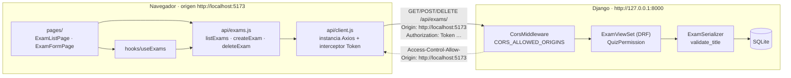

# Lab 12 — Ajax y Servicios Web: React + Axios consumiendo la API de Django

[](https://github.com/jordanabad797-pixel/Lab12-Django-React/actions/workflows/ci.yml)

**Curso:** Desarrollo de Aplicaciones Empresariales (4-C24-A) · **Semana:** 12 · **Docente:** Michael Montgomery Rosell
**Alumno:** Alonso Abad Mejia

Este repositorio contiene **los dos lados** del laboratorio:

| Carpeta | Qué es | Tecnología | Dirección en desarrollo |
|---|---|---|---|
| [`backend/`](backend) | API REST de cuestionarios del Lab 08 (Exam, Question, Choice) con **CORS habilitado** | Django 6 · Django REST Framework · django-cors-headers | `http://127.0.0.1:8000` |
| [`frontend/`](frontend) | Cliente SPA que **lista, crea y elimina** exámenes con Axios y resuelve los estados de **carga, datos y error** | React 19 · Vite · React Router · Axios | `http://localhost:5173` |

---

## 1. Arquitectura



- El **navegador** es quien aplica la política del mismo origen: React (`localhost:5173`) y Django (`127.0.0.1:8000`) son orígenes distintos, por eso la API debe responder con `Access-Control-Allow-Origin`.
- Toda dirección de la API vive en **un solo sitio** (`frontend/src/api/config.js`); ningún componente escribe URLs.
- `parseApiError` (`frontend/src/api/errors.js`) convierte cualquier fallo de Axios en un objeto `{ kind, title, message, status, fieldErrors }` que la interfaz sabe dibujar.

## 2. Qué origen espera cada lado

| Lado | Espera | Dónde se configura |
|---|---|---|
| **Backend (Django)** | Solo acepta peticiones de navegador desde los orígenes **exactos** `http://localhost:5173` y `http://127.0.0.1:5173`. No hay comodín (`CORS_ALLOW_ALL_ORIGINS = False`) y solo `/api/` se expone (`CORS_URLS_REGEX`). | `backend/.env` → `DJANGO_CORS_ALLOWED_ORIGINS` |
| **Frontend (React)** | Llama a la API en `http://127.0.0.1:8000/api` y se sirve **siempre** en el puerto `5173` (`strictPort: true`); si el puerto está ocupado Vite falla en lugar de saltar a 5174, que no estaría autorizado. | `frontend/.env.local` → `VITE_API_URL`, `VITE_API_TOKEN`; `frontend/vite.config.js` |

> Para otro entorno (p. ej. producción) basta con declarar su dominio en `DJANGO_CORS_ALLOWED_ORIGINS`, separado por comas. No se toca el código.

## 3. Cómo levantar los dos lados

Requisitos: Python 3.12+, Node.js 22.12+ (lo exigen Vitest 5 y jsdom 31), Git.

### 3.1 Backend — terminal 1

```powershell
cd backend
python -m venv .venv
.venv\Scripts\activate
pip install -r requirements.txt
copy .env.example .env
# Genera una clave y pégala en DJANGO_SECRET_KEY dentro de .env:
python -c "from django.core.management.utils import get_random_secret_key as k; print(k())"
python manage.py migrate
python manage.py seed_quiz        # crea datos de ejemplo e imprime QUIZ_TOKEN_HUMANO
python manage.py runserver 127.0.0.1:8000
```

Comprobación: abrir `http://127.0.0.1:8000/api/` y `http://127.0.0.1:8000/api/exams/` en el navegador.

### 3.2 Frontend — terminal 2

```powershell
cd frontend
npm install
copy .env.example .env.local
# Pega en VITE_API_TOKEN el valor de QUIZ_TOKEN_HUMANO que imprimió seed_quiz
npm run dev                       # http://localhost:5173
```

### 3.3 Variables de entorno

| Archivo | Variable | Ejemplo | Uso |
|---|---|---|---|
| `backend/.env` | `DJANGO_SECRET_KEY` | (aleatoria) | Clave de Django; ya no está escrita en `settings.py` |
| | `DJANGO_DEBUG` | `True` | Modo desarrollo |
| | `DJANGO_ALLOWED_HOSTS` | `127.0.0.1,localhost` | Hosts aceptados |
| | `DJANGO_CORS_ALLOWED_ORIGINS` | `http://localhost:5173,http://127.0.0.1:5173` | Orígenes autorizados por CORS |
| `frontend/.env.local` | `VITE_API_URL` | `http://127.0.0.1:8000/api` | Dirección base de la API |
| | `VITE_API_TOKEN` | `796e…` | Token DRF del usuario `profe` (crear y eliminar requieren autenticación) |

Ambos archivos están en `.gitignore`; en el repositorio solo se versionan las plantillas `.env.example`.

## 4. Servicios consumidos

| Operación | Función del cliente | Petición | Respuesta esperada |
|---|---|---|---|
| Listar | `listExams({ page, search })` | `GET /api/exams/?page=1&search=` | `200` `{ count, next, previous, results }` |
| Crear | `createExam({ title, description })` | `POST /api/exams/` | `201` examen creado · `400` errores por campo |
| Eliminar | `deleteExam(id)` | `DELETE /api/exams/{id}/` | `204 No Content` |

## 5. Tabla de la pantalla de listado (estados de la petición)

| Momento | Petición | Estado | Qué se muestra |
|---|---|---|---|
| Al entrar a `/exams` | `GET /api/exams/?page=1` dentro de `useEffect` | **Carga** (`isLoading && !data`) | Esqueleto animado de 5 filas con el texto “Cargando exámenes…” (`role="status"`, `aria-busy`) |
| Respuesta `200` | — | **Datos** | Tabla con ID, título, descripción, n.º de preguntas, fecha y botón Eliminar; paginación; si no hay filas, estado vacío con enlace a “Crear examen” |
| Sin respuesta / `4xx` / `5xx` | — | **Error** | Tarjeta roja con icono, título del problema, explicación, tipo (`network`, `auth`, `server`…) y código HTTP, y botón **Reintentar** que repite la petición |
| Tras eliminar o actualizar | `GET` de la página actual | Datos + refresco | La tabla se atenúa mientras llega la nueva respuesta (no se vuelve a mostrar el esqueleto) |

## 6. Errores provocados y observaciones

1. **CORS sin origen autorizado.** Con `DJANGO_CORS_ALLOWED_ORIGINS=http://localhost:3000` la API sigue respondiendo `200`, pero sin `Access-Control-Allow-Origin`; el navegador bloquea la respuesta y la consola muestra: *“…has been blocked by CORS policy: No 'Access-Control-Allow-Origin' header is present on the requested resource.”* Axios recibe un `ERR_NETWORK` sin `response`, y la interfaz muestra el estado de error. Al restaurar el origen, **Reintentar** recupera los datos.
2. **Validación desde el formulario.** Enviar el título vacío devuelve `400 {"title": ["El título es obligatorio."]}`; el mensaje se dibuja bajo el campo, que se marca con `aria-invalid`. Un título repetido devuelve “Ya existe un examen con ese título.”.
3. **Servidor apagado.** Con React abierto se detiene `runserver` y se pulsa **Actualizar**: aparece la tarjeta de error (no una pantalla en blanco). Al levantar Django, **Reintentar** vuelve a mostrar la tabla.
4. Desde JavaScript **no se puede distinguir** un bloqueo de CORS de un servidor caído (en ambos casos no hay `response`); por eso el mensaje menciona las dos causas y la consola del navegador es la que da el detalle.
5. El token en `VITE_API_TOKEN` es una simplificación de laboratorio: todo lo que se empaqueta con Vite es visible en el navegador. En producción se usaría un inicio de sesión que obtenga el token del usuario.
6. Como la autenticación va en la cabecera `Authorization` y no en cookies, `CORS_ALLOW_CREDENTIALS` queda en `False`.

Las capturas de todos los casos están en [`docs/evidencias/`](docs/evidencias).

## 7. Pruebas

```powershell
cd backend;  python manage.py test         # 20 pruebas (CORS, validación, permisos, cliente de consola, agente)
cd frontend; npm run lint                  # ESLint (configuración plana: react-hooks y react-refresh)
cd frontend; npm test                      # 28 pruebas (parseApiError, estados del listado, borrado, formulario, Pagination, DeleteButton, ErrorMessage)
```

Las mismas comprobaciones se ejecutan en GitHub Actions ([`.github/workflows/ci.yml`](.github/workflows/ci.yml)) en cada `push` y `pull_request` a `main`: el job **backend** (Python 3.12) corre `python manage.py test` y el job **frontend** (Node 22) corre `npm ci`, `npm run lint`, `npm test` y `npm run build`.

## 8. Normas aplicadas

- **Python / Django:** PEP 8, una aplicación por responsabilidad (`quiz`), modelos en singular, migraciones versionadas y `settings.py` sin credenciales escritas a mano.
- **React:** componentes en PascalCase, hooks con prefijo `use`, una carpeta por componente/página con su CSS y sus pruebas.
- Código, nombres y comentarios en inglés; documentación y entregables en español.

## 9. Historial de commits

Cada paso del procedimiento está en su propio commit (ver `git log --oneline`): importación del Lab 08 → variables de entorno → CORS → validación del serializador → proyecto React → módulo cliente Axios → listado con tres estados → borrado → formulario de alta → pruebas → corrección → documentación y evidencias.

## 10. Equipo y aportes

| Integrante | Aportes |
|---|---|
| **Alonso Abad Mejia** | Implementación del laboratorio: backend con CORS, cliente React, páginas, pruebas y evidencias. |
| **Farid Chávez Campos** | ESLint en el frontend (incluida la corrección del aviso `react-hooks/set-state-in-effect` en `useExams.js`), pruebas de `Pagination`, `DeleteButton` y `ErrorMessage`, e integración continua con GitHub Actions. |
